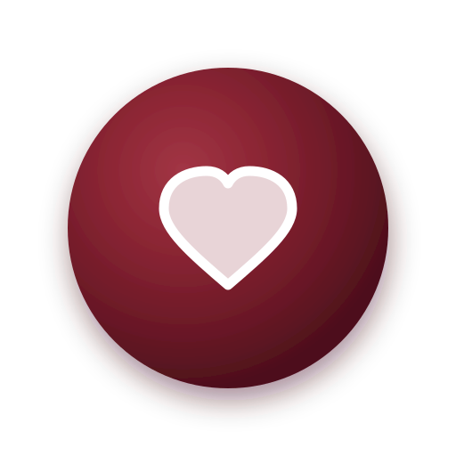
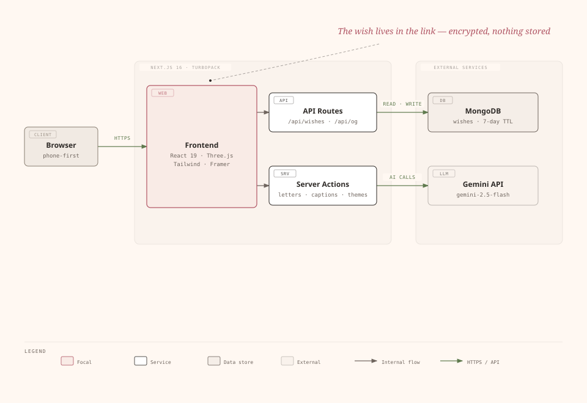

<div align="center">



# WishMaker.

*Turn a birthday wish into an unforgettable, interactive keepsake — in one link*

[](https://nextjs.org)
[](https://react.dev)
[](https://www.typescriptlang.org)
[](https://tailwindcss.com)
[](https://ai.google.dev)
[](https://www.mongodb.com)
[](LICENSE)

[Features](#features) • [Getting started](#getting-started) • [How it works](#how-it-works) • [Architecture](#architecture) • [Configuration](#configuration) • [Privacy](#privacy) • [Project structure](#project-structure)

</div>

WishMaker turns a birthday wish into a choreographed, multi-chapter experience: a wax-sealed envelope, a 3D cake you can blow out with your microphone, a letter written from your own answers, shared photos, a voice note, and a fireworks finale — all packed into a single URL. No accounts, no app to install. The link stays open for a week, and the recipient can save the whole keepsake to their device forever.

The recipient just opens the link; the gift-maker just sends it.

## Features

- 🕯️ **Wax-sealed envelope** — A dark linen envelope locked with a crimson wax seal. Set a delivery date and it stays sealed behind a countdown until the big day.
- 🎂 **3D cake with mic candle-blowing** — A gourmet Three.js cake. Tap a candle or blow into your microphone to blow them out, with physics-based smoke.
- ✉️ **Interview letter writer** — Answer six small questions (by typing, or out loud with voice transcription) and Gemini drafts three letters built only from your real memories — 90–140 words, never greeting-card filler. A Quick mode keeps the older what-to-say / keywords path.
- 🎨 **Smart theme recommendation** — Gemini reads the letter and recommends a matching color palette (starry, neon, romance, pastel, retro) and ambience.
- 📸 **Auto-captioned photos** — Upload a memory photo and Gemini vision writes a warm caption for the polaroid.
- 🎵 **Birthday tune** — Four built-in Happy Birthday melodies, or upload your own; the first ~15s plays at the finale.
- 🕰️ **Chronological journey** — A sequenced reveal: letter → cake → birthday wish → jar of scrolls → photo scrapbook → Open When capsules → timeline → voice note → fireworks finale.
- 🎁 **Scheduled delivery** — Lock the surprise behind a countdown until the chosen date; only the countdown data ever reaches the browser early.
- 💬 **Reply chapter** — The recipient answers with one tap (🥹 ❤️ 😂 🙏 🫂), a written note, or a voice message, which opens back to the sender as a keepsake.
- 👀 **Read receipt** — A private tracker link tells the sender when the keepsake was opened and what came back.
- 💾 **Keepsake export** — One tap saves the entire experience as a single offline HTML file, so it outlives the seven-day link.

## Getting started

### Prerequisites

You need a [Gemini API key](https://ai.google.dev/) and, for wish persistence, a MongoDB connection string.

Create a `.env.local` file at the project root:

```env
GEMINI_API_KEY=your_gemini_api_key_here
MONGODB_URI=mongodb+srv://your_atlas_connection_string
```

> [!TIP]
> The core "link in a URL" experience works with just `GEMINI_API_KEY`. MongoDB is only used for the optional persisted-wish flow (`/api/wishes`).

### Install and run

```bash
npm install
npm run dev
```

Open [http://localhost:3000](http://localhost:3000) to start creating.

### Production build

```bash
npm run build
npm run start
```

## How it works

There are two surfaces, split by audience:

**The gift-maker** (`/create`) — a six-step wizard: name the honoree, answer the interview (or write the letter directly), pick a cake, a tune and a handwriting style, fill the jar of scrolls, add photos and Open When capsules, then record a voice note and seal. It returns the keepsake link plus a private tracker link.

**The recipient** (`/wish/[id]`) — a phone-first, choreographed reveal. Each stage must be completed before the next unlocks, building toward the finale, where they can save the keepsake and send something back.

### The recipient's journey

Opening the link begins a sequenced, chronological reveal — each stage unlocks the next:

1. **Wax-seal envelope** — A linen envelope sealed in crimson wax; breaking it plays a paper-and-seal sound. With a delivery date set, a countdown keeps it sealed until the big day.
2. **Handwritten letter** — The message renders in the sender's chosen hand (flowing, casual or soft).
3. **3D cake & blow** — A gourmet Three.js cake. The recipient taps a candle or blows into their microphone to blow them out, with physics-based smoke.
4. **Birthday wish** — Typed wishes ascend to the sky with confetti.
5. **Jar of little scrolls** — Rolled parchment notes unroll one by one.
6. **Photo scrapbook** — Polaroid-style memories with handwritten captions.
7. **Open When capsules** — Sealed notes for hard days, quiet mornings, and future moments.
8. **Timeline** — Milestones, when the sender added them.
9. **Whispered voice note** — The sender's actual voice, played before the finale.
10. **Grand finale** — Fireworks, the keepsake download, one-tap/text/voice reply, and a nudge to create one for someone they love.

## Architecture

WishMaker is a single Next.js app: the frontend and backend live in one process, split by route convention. Client-side config is encrypted and carried in the share URL; only optional persisted wishes touch a database.



- **Client** — the phone-first browser, no signup or install required.
- **Frontend** — React 19, Three.js, Tailwind, and Framer Motion rendering the landing, creator wizard, and recipient experience.
- **Server Actions** (`src/lib/actions.ts`) — Gemini-backed interview letter drafting, voice transcription, photo captioning and scroll notes.
- **API Routes** (`src/app/api/`) — `/api/wishes/[id]` for the keepsake, `/api/replies` for reactions, notes and voice replies, `/api/wishes/[id]/open` for the read-receipt beacon, and `/api/og` for dynamic Open Graph images.
- **Gemini API** — `gemini-2.5-flash` powers all AI features.
- **MongoDB** — wish store with a TTL index deleting rows 7 days after delivery; the saved HTML export is what outlives it.
- **Read receipts** — `/sent/[id]?k=…`, guarded by a private per-keepsake key that never appears in the public payload.

> [!NOTE]
> The interactive diagram is also available as a self-contained HTML file: [`architecture.html`](architecture.html).

## Configuration

| Variable | Required | Description |
| --- | --- | --- |
| `GEMINI_API_KEY` | Yes (for AI features) | Google AI key used for letter drafts, theme recommendations, and photo captions. |
| `MONGODB_URI` | Optional | MongoDB connection string for the persisted-wish flow. |

## Privacy

WishMaker sets **no cookies** and tracks **no analytics**. Camera photos never leave the recipient's device. A keepsake lives in MongoDB for **7 days** after its delivery date (TTL index) — after that the row is gone, which is why the finale offers a self-contained offline export. Opening counts are anonymous and stored on the wish itself; the tracker link is the only way to read them.

## Tech stack

- **Next.js 16** (Turbopack) + React 19, Server Actions & route handlers
- **TypeScript** throughout
- **Tailwind CSS v4** with a warm, cozy design system (shadcn / Base UI primitives)
- **Three.js** for the 3D cake, candles, and fireworks
- **Framer Motion** for stage transitions
- **Mongoose / MongoDB** for the optional wish store
- **Gemini API** (`gemini-2.5-flash`) for letters, themes, and photo captions

## Project structure

```
src/
├── app/
│   ├── page.tsx            # Landing page
│   ├── create/             # Gift-maker wizard
│   ├── wish/               # Recipient experience (WishViewer)
│   └── api/
│       ├── wishes/         # Optional persisted wishes (MongoDB)
│       └── og/             # Dynamic Open Graph images
├── components/
│   ├── birthday/           # Cake, candles, fireworks, memory lane, trivia, balloons…
│   ├── create/             # Wizard forms (cake style, tunes, memories, trivia)
│   └── ui/                 # Buttons, step bar, ambient canvas, voice recorder
├── lib/                    # AI actions, audio/jingle, MongoDB, styles, utils
├── models/                 # Mongoose schemas
└── types/                  # Shared types
```

## Acknowledgements

- Birthday melodies from Pixabay contributors
- Hero photography from [Unsplash](https://unsplash.com)
